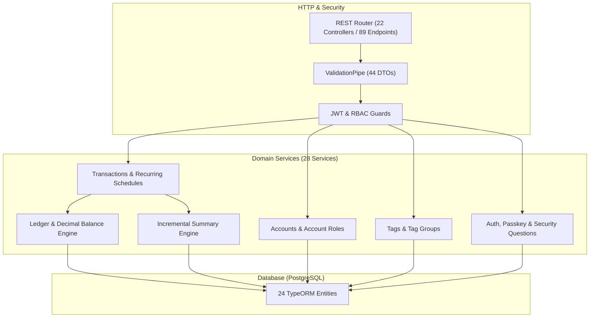

# MindVault Backend

A modular, multi-user REST API and financial ledger engine engineered with NestJS, TypeORM, and PostgreSQL.

## At a glance

| Field | Value |
| :--- | :--- |
| **Role** | Solo Backend Engineer |
| **Ownership** | Solo (100% of codebase; 100 commits in repository) |
| **Timeline** | October 17, 2025 – December 12, 2025 |
| **Status** | Completed (Core finance, multi-user RBAC, and tags system complete; personal growth suite planned) |
| **Type** | REST API & Backend Service (NestJS) |
| **Company / Context** | Personal project |
| **Links** | [Backend Repository](https://github.com/marceldavidbaroi/MindVault_Backend) \| [Frontend Repository](https://github.com/marceldavidbaroi/MindVault_Frontend) \| [Portfolio](https://marceldavidbaroi.pages.dev/) |

## The problem

Personal finance applications frequently suffer from floating-point calculation drift, fragile audit trails, and slow analytics when aggregating large transaction histories across multiple accounts and currencies. Without strict transactional guarantees, pre-aggregated summaries, and contextual permission boundaries, balance reconciliation breaks down in multi-user environments.

## The solution

Accomplished a high-precision, role-aware financial ledger API as measured by 89 REST endpoints, 24 relational database entities, and 82 automated test cases by architecting a modular NestJS engine with TypeORM, automated summary pipelines, and arbitrary-precision arithmetic.

- **Double-Entry-Style Ledger**: Maintains account balances and an immutable `AccountLedger` audit trail with arbitrary-precision arithmetic.
- **Incremental Summary Pipeline**: Automatically maintains daily, weekly, monthly, yearly, and category aggregate entities on transaction mutations.
- **Contextual Account RBAC**: Enforces account-specific roles (`AccountUserRole`: Owner, Admin, Editor, Viewer) alongside global JWT authentication.
- **Hierarchical Tag Management**: Categorizes transactions into structured tag groups with full soft-delete and recycle bin restoration.
- **Automated Database Seeding**: Provides 6 CLI commands (`nestjs-command`) to bootstrap roles, categories, currencies, account types, and tags.

## What I built

I designed, architected, and implemented the entire MindVault backend from scratch as a solo engineer.

> **Guidance / not mine**: None. System architecture, relational schema, API contracts, security flows, and module design were independently architected and implemented by me.

- **Modular NestJS Architecture**: Architected 11 modules isolating controllers, services, repositories, validators, DTOs, and seeders.
- **Precision Balance Engine**: Implemented ledger calculations using `decimal.js` (`safeAdd`, `safeSubtract`) to eliminate rounding drift and prevent negative balances.
- **Real-Time Aggregation Engine**: Built transactional hooks that update 6 summary entities across daily, weekly, monthly, yearly, and category dimensions.
- **Multi-Factor Auth & Session Tracking**: Implemented JWT cookie/bearer auth, passkey verification, security questions, active session tracking, and password reset logging.
- **Account-Level RBAC**: Engineered contextual permission guards and user-to-account role mappings (`AccountUserRole`) to isolate multi-tenant operations.
- **CLI Database Seeders**: Created 6 CLI commands via `nestjs-command` to seed default roles, categories, currencies, account types, and tags.

## Key engineering decisions

- **Monetary Precision via Arbitrary-Precision Math**
  - *Challenge*: Native JavaScript IEEE 754 floating-point arithmetic introduces rounding inaccuracies that cause account balances to drift over repeated transactions.
  - *Decision*: Stored monetary amounts as string/numeric values and implemented helper routines (`safeAdd`, `safeSubtract`) using `decimal.js` that enforce non-negative balance checks. Trade-off: Required explicit type parsing across services and DTOs.
  - *Outcome*: Guaranteed exact monetary accuracy and prevented balance underflow errors across all transactions and ledgers.
- **Pre-Aggregated Summaries vs. Dynamic Query Computation**
  - *Challenge*: Computing multi-interval trends (daily, weekly, monthly, yearly) on demand required expensive `SUM` and `GROUP BY` database queries across growing transaction histories.
  - *Decision*: Designed dedicated summary entities updated transactionally whenever transactions are created, modified, or deleted. Trade-off: Added write-path overhead during transaction mutations.
  - *Outcome*: Achieved O(1) query latency for dashboard analytics, comparative summaries, and trend charts.
- **Contextual Account Authorization vs. Global Roles**
  - *Challenge*: Users require varying permission levels across distinct accounts (e.g., owner of a personal account, but viewer on a shared family account).
  - *Decision*: Decoupled global authentication from account authorization by introducing an explicit `AccountUserRole` junction entity with custom NestJS guards. Trade-off: Required additional lookup joins on account-scoped requests.
  - *Outcome*: Enforced strict multi-user access boundaries without duplicating accounts or elevating global role privileges.
- **Repository & Validator Separation for Tag Engine**
  - *Challenge*: Tag management required soft deletion, group association, and multi-entity tagging without polluting controllers or general services.
  - *Decision*: Implemented dedicated custom repositories (`TagsRepository`, `TagGroupsRepository`), validators (`TagsValidator`), and transformers (`TagsTransformer`). Trade-off: Increased module class count.
  - *Outcome*: Created a clean, decoupled tagging subsystem supporting soft delete and recycle bin restoration.

## Architecture

The backend is built with NestJS, utilizing modular architecture and TypeORM to interface with PostgreSQL. Requests pass through global validation pipes and JWT/RBAC guards before entering domain controllers, which invoke services to update accounts, ledgers, and pre-aggregated summaries.



- **Layer organization**: `Controller` → `ValidationPipe (DTO)` → `Service` → `Repository / TypeORM` → `PostgreSQL`

## Tech stack

| Layer | Technologies |
| :--- | :--- |
| **Framework** | NestJS 11.0.1, TypeScript 5.7.3 |
| **Database & ORM** | PostgreSQL (`pg` 8.16.3), TypeORM 0.3.26 (24 entities) |
| **Authentication & Security** | Passport, Passport JWT 4.0, bcrypt 6.0, cookie-parser 1.4 |
| **Math & Validation** | decimal.js 10.6, class-validator 0.14, class-transformer 0.5, dayjs 1.11 |
| **DevOps** | Docker, Docker Compose |
| **Testing** | Jest 30, ts-jest 29, Supertest 7 (82 test cases across 10 spec files) |
| **Tooling** | pnpm, ESLint 9, Prettier 3, nestjs-command 3.1.5, Swagger UI Express 5.0 |

## Screenshots / demo

<!-- TODO(me): Add 1-2 Swagger UI or API demonstration screenshots to the repository and embed them here -->

## Results and numbers

| Metric | Count | Measurement Type |
| :--- | :--- | :--- |
| **REST Endpoints** | 89 endpoints across 22 controllers | Measured |
| **Domain Services** | 28 services | Measured |
| **Relational Entities / Tables** | 24 TypeORM entities | Measured |
| **Data Transfer Objects (DTOs)** | 44 DTOs | Measured |
| **CLI Seeders** | 6 commands (roles, categories, currencies, account types, tag groups, tags) | Measured |
| **Automated Test Cases** | 82 test cases across 10 test files (unit & e2e) | Measured |
| **Git Commits** | 100 commits (100% solo authorship) | Measured |

## Run it locally

### Prerequisites
- Node.js (>= 18.x)
- PostgreSQL (running locally or via Docker)
- pnpm or npm

### Setup instructions

1. Navigate to the backend directory:
   ```bash
   cd Backend
   ```
2. Configure environment variables in `.env`:
   - Required names: `API_PREFIX`, `CORS_ORIGIN`, `CORS_CREDENTIALS`, `DATABASE_HOST`, `DATABASE_PORT`, `DATABASE_USER`, `DATABASE_PASSWORD`, `DATABASE_NAME`, `NODE_ENV`, `PORT`, `JWT_SECRET`
3. Install dependencies:
   ```bash
   pnpm install
   ```
4. Run database seeders:
   ```bash
   npm run seed:roles
   npm run seed:categories
   npm run seed:currency
   npm run seed:account-types
   npm run seed:tag-groups
   npm run seed:tags
   ```
5. Start development server:
   ```bash
   npm run start:dev
   ```
   - Swagger documentation is available at `http://localhost:3000/api/v1/docs`
6. Run tests:
   ```bash
   npm test
   ```
7. Build for production:
   ```bash
   npm run build
   ```

## Project structure

```
MindVault_Backend/
├── Backend/
│   ├── src/
│   │   ├── auth/           # JWT, passkey, security questions, session entities & services
│   │   ├── common/         # Decimal balance math utilities, standard API response types
│   │   ├── config/         # TypeORM datasource & database connection configuration
│   │   ├── finance/        # Accounts, transactions, ledgers, categories, currency, summaries
│   │   ├── roles/          # System roles, role seeder, and permission enforcement
│   │   ├── tags/           # Tag groups, tags, custom repositories, transformers, validators
│   │   ├── app.module.ts   # Root application module registering domain modules
│   │   └── main.ts         # NestJS bootstrap, Swagger config, CORS, and CLI runner
│   ├── test/               # E2E test suite (app.e2e-spec.ts)
│   ├── Dockerfile          # Container build definition for NestJS service
│   ├── docker-compose.yml  # Container orchestration
│   └── package.json        # Dependencies and scripts
└── Documentation/          # Docusaurus documentation workspace
```

## Roadmap

- [x] Multi-user authentication & recovery (JWT, passkeys, security questions, sessions) — *Shipped*
- [x] Multi-user account collaboration & contextual RBAC (Owner, Admin, Editor, Viewer) — *Shipped*
- [x] Transaction processing & immutable account ledger with arbitrary-precision math — *Shipped*
- [x] Real-time pre-aggregated summaries (daily, weekly, monthly, yearly, category) & trend insights — *Shipped*
- [x] Hierarchical tagging & soft-delete recycle bin recovery — *Shipped*
- [ ] Financial statement PDF and CSV report export engine (`pdfkit` / `csv-stringify`) — *Planned*
- [ ] Personal growth suite backend services (LifeLog, Contacts directory, Capsule reflection, Knowledge base, Micro Actions, Storyline) — *Planned*

## License / contact

Private / proprietary personal project. Code is unlicensed (`UNLICENSED`).

- **Author**: Marcel David Baroi
- **Portfolio**: [https://marceldavidbaroi.pages.dev/](https://marceldavidbaroi.pages.dev/)
- **GitHub**: [marceldavidbaroi](https://github.com/marceldavidbaroi)
